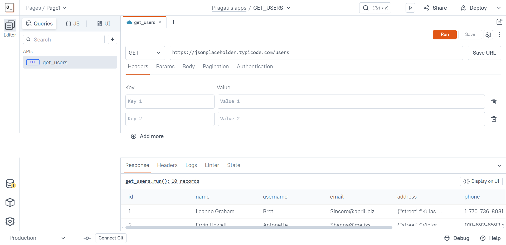
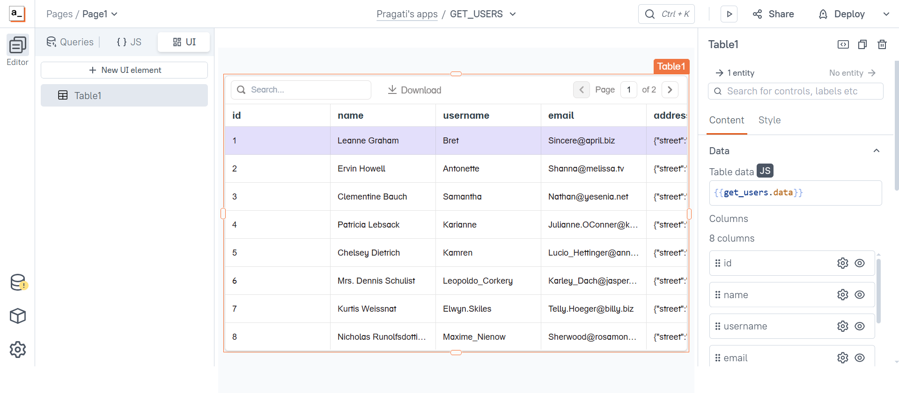

# Quickstart: Integrate a REST API and Bind Data to a Table in Appsmith

Configure a `GET` REST API query in [Appsmith](https://appsmith.com) and bind the JSON response to a **Table** widget to render live user records. In under five minutes, you connect an external endpoint, inspect the response payload, and populate a searchable data table.

## Prerequisites

Before you start, verify that you have:

* An active [Appsmith Cloud](https://appsmith.com) workspace.
* A basic understanding of REST endpoints, HTTP `GET` requests, and JSON objects.
* Access to the public JSONPlaceholder users endpoint: `https://jsonplaceholder.typicode.com/users`.

## Step 1: Initialize the Application

1. Sign in to your [Appsmith Cloud](https://appsmith.com) workspace.
2. Select **Create New** (or dismiss the datasource prompt) to open the application editor.
3. Select the application name in the top-left header and rename it to `User Directory Data Grid`.

## Step 2: Configure and Execute the REST API Query

1. Select **Queries** in the left navigation panel.
2. Select **`+`** (or **New Blank API**) to create a new REST API query.
3. Select the query name at the top and rename it to `get_users`.
4. Confirm that the HTTP method dropdown is set to **GET**.
5. Enter `https://jsonplaceholder.typicode.com/users` in the URL input field.
6. Select **Run** in the top-right corner of the query editor.



A successful request returns a `200 OK` status with 10 user records in the **Response** pane:

```json
[
  {
    "id": 1,
    "name": "Leanne Graham",
    "username": "Bret",
    "email": "Sincere@april.biz",
    "company": {
      "name": "Romaguera-Crona"
    }
  },
  {
    "id": 2,
    "name": "Ervin Howell",
    "username": "Antonette",
    "email": "Shanna@melissa.tv",
    "company": {
      "name": "Deckow-Crist"
    }
  }
]
```
## Step 3: Bind Query Output to a Table Widget

1. Select **UI** in the left navigation panel.
2. Drag a **Table** widget from the widget list onto the canvas.
3. Select the **Table** widget to open the **Property Pane** on the right.
4. Locate **Table data** under **Data** and enter `{{get_users.data}}`.
5. Resize the widget on the canvas to display the columns clearly.

## Verify It Works

Once `{{get_users.data}}` is bound, the **Table** widget renders the user records returned by `get_users`, exposing fields such as **id**, **name**, **username**, and **email**.



Enter a query in the **Search...** input above the table to verify client-side filtering across rows.

## Troubleshooting Common Errors

| Error / Symptom | Root Cause | Resolution |
| :--- | :--- | :--- |
| **`404 Not Found`** | The endpoint URL has a typo or missing path segment. | Verify the URL is `[https://jsonplaceholder.typicode.com/users](https://jsonplaceholder.typicode.com/users)` with no extra spaces. |
| **Table remains empty** | The `get_users` query has not run, or the binding expression is malformed. | Select **Run** on `get_users`, then confirm **Table data** uses `{{get_users.data}}`. |
| **`CORS / Network Error`** | Appsmith Cloud cannot directly reach an unexposed `localhost` service. | Use a publicly reachable HTTPS endpoint or run Appsmith locally with Docker. |

## Next Steps

* **Support Write Operations:** Add a `POST` API query connected to a form widget to create new records.
* **Customize Columns:** Use the **Property Pane** under **Columns** to hide, rename, or format specific table columns.
* **Publish the Application:** Select **Deploy** in the top-right corner to release a shareable build.


