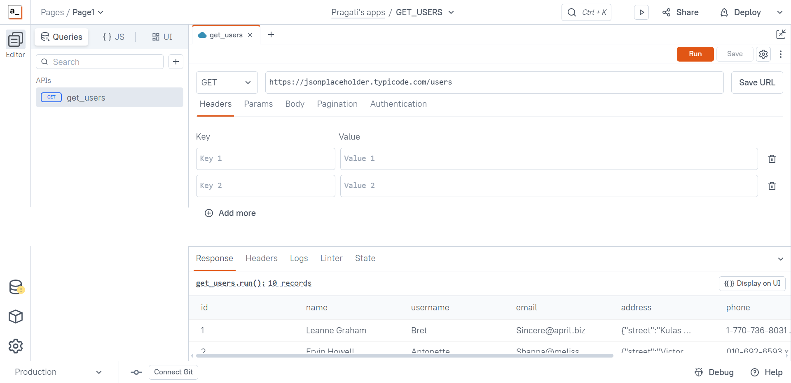

# Quickstart: Integrate a REST API and Bind Data to a Table in Appsmith

Configure a `GET` REST API query in Appsmith and bind the JSON response to a **Table** widget to render live user records. In under five minutes, you connect an external endpoint, inspect the response payload, and populate a searchable data table.

## Prerequisites

Before you start, verify that you have:

* An active [Appsmith Cloud](https://app.appsmith.com/) workspace.
* A basic understanding of REST endpoints, HTTP `GET` requests, and JSON objects.
* Access to the public JSONPlaceholder users endpoint: `https://jsonplaceholder.typicode.com/users`.

## Step 1: Initialize the Application

1. Sign in to your [Appsmith Cloud](https://app.appsmith.com/) workspace.
2. Select **Create New** (or dismiss the datasource prompt) to open the application editor.
3. Select the application name in the top-left header and rename it to `User Directory Data Grid`.

## Step 2: Configure and Execute the REST API Query

1. Select **Queries** in the left navigation panel.
2. Select **`+`** (or **New Blank API**) to create a new REST API query.
3. Select the query name at the top and rename it to `get_users`.
4. Confirm that the HTTP method dropdown is set to **GET**.
5. Enter `https://jsonplaceholder.typicode.com/users` in the URL input field.
6. Select **Run** in the top-right corner of the query editor.



A successful request returns a `200 OK` status with 10 user records in the **Response** pane:

```json
[
  {
    "id": 1,
    "name": "Leanne Graham",
    "username": "Bret",
    "email": "Sincere@april.biz",
    "company": {
      "name": "Romaguera-Crona"
    }
  },
  {
    "id": 2,
    "name": "Ervin Howell",
    "username": "Antonette",
    "email": "Shanna@melissa.tv",
    "company": {
      "name": "Deckow-Crist"
    }
  }
]
